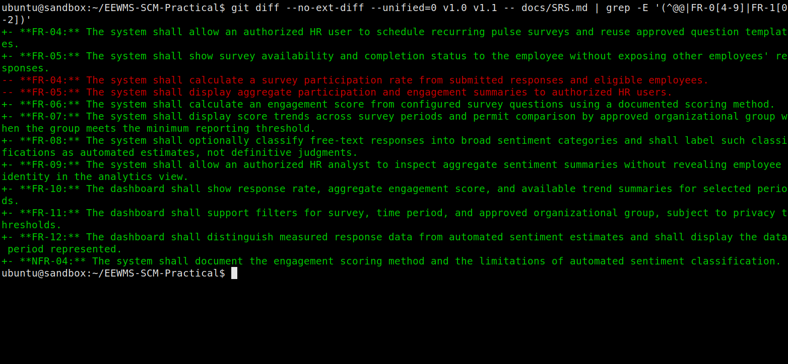
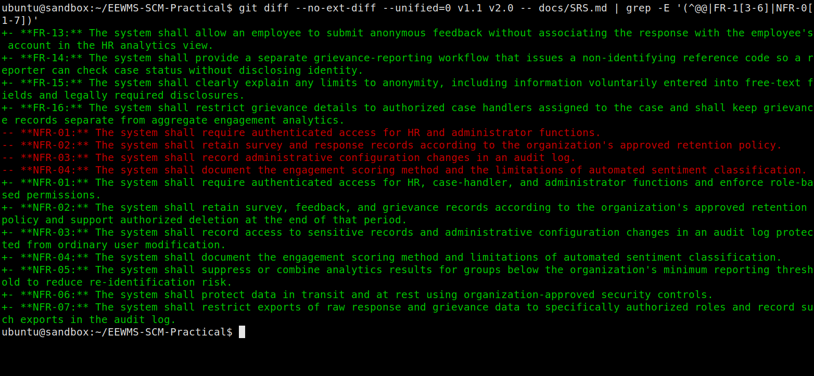
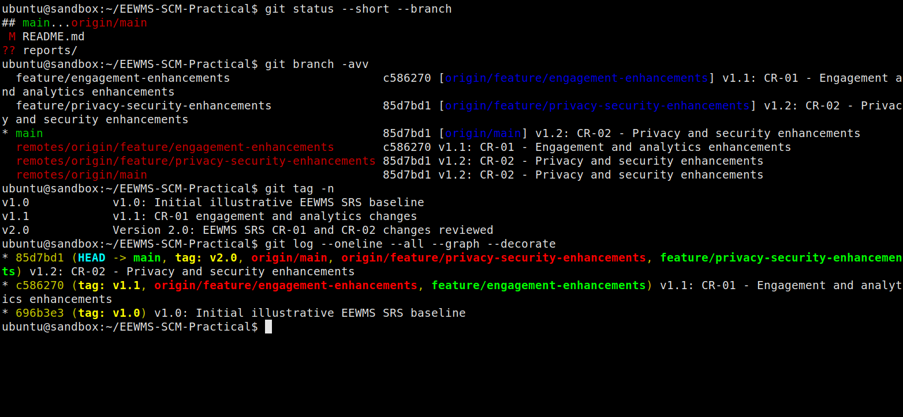
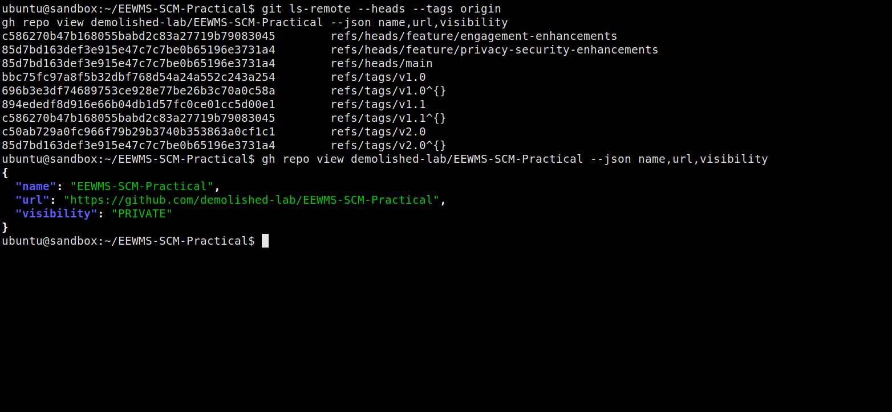

# Experiment 10 — Software Configuration Management

## Git and GitHub: EEWMS SRS version control

**Execution date:** 15 October 2026  
**Repository:** [demolished-lab/EEWMS-SCM-Practical](https://github.com/demolished-lab/EEWMS-SCM-Practical)  
**Visibility:** Private  
**Default branch:** `main`  
**Git version:** 2.43.0

> I ran the commands in this practical in the task sandbox connected to the GitHub account. The screenshots below are direct captures of actual xterm windows while running Git commands against this repository; they are not AI-generated terminal mockups. The report uses first-person lab-report wording. The requirements are illustrative because no separate approved EEWMS SRS source file was supplied.

## 1. Aim

In this practical, I used Git and GitHub to establish an SRS baseline, implement two illustrative change requests on feature branches, merge the changes, create version tags, and inspect the resulting history and differences.

## 2. Repository contents and change plan

I created the private GitHub repository with `README.md` and the editable source document `docs/SRS.md`. I used Markdown so that Git can show readable text-level changes; a PDF is not used as the version-controlled source.

| SCM milestone | Branch or tag | Change represented |
| --- | --- | --- |
| Baseline | `main`, tag `v1.0` | Initial illustrative SRS requirements |
| Change Request 1 | `feature/engagement-enhancements`, tag `v1.1` | Pulse surveys, engagement scoring, sentiment analysis, HR analytics |
| Change Request 2 | `feature/privacy-security-enhancements` | Anonymous feedback, grievance reporting, privacy-aware analytics, access/security requirements |
| Final release | `main`, tag `v2.0` | Combined SRS revision 1.2 |

I manually edited the SRS between Git commands on each feature branch. Those editor-based changes did not produce terminal output; the following record shows the actual Git and GitHub terminal operations.

## 3. Procedure and actual terminal record

### Step 1 — Create and verify the GitHub repository

I created the repository as a private repository under the authenticated GitHub account. I then verified its URL and private visibility:

```text
$ gh repo view demolished-lab/EEWMS-SCM-Practical --json
  name,url,visibility
{
  "name": "EEWMS-SCM-Practical",
  "url": "https://github.com/demolished-lab/EEWMS-SCM-Practical",
  "visibility": "PRIVATE"
}
```

### Step 2 — Initialize the local repository and commit the v1.0 baseline

Commands executed:

```bash
git init -b main
git status --short
git add README.md docs/SRS.md
git status --short
git commit -m "v1.0: Initial illustrative EEWMS SRS baseline"
git tag -a v1.0 -m "v1.0: Initial illustrative EEWMS SRS baseline"
gh auth setup-git
git remote add origin \
  https://github.com/demolished-lab/EEWMS-SCM-Practical.git
git push -u origin main
```

Observed outputs:

```text
Initialized empty Git repository in
  /home/ubuntu/EEWMS-SCM-Practical/.git/

$ git status --short
?? README.md
?? docs/

$ git status --short
A  README.md
A  docs/SRS.md

[main (root-commit) 696b3e3] v1.0: Initial illustrative EEWMS SRS
  baseline
 2 files changed, 63 insertions(+)
 create mode 100644 README.md
 create mode 100644 docs/SRS.md

To https://github.com/demolished-lab/EEWMS-SCM-Practical.git
 * [new branch]      main -> main
branch 'main' set up to track 'origin/main'.
```

The annotated `v1.0` tag, Git credential setup, and remote configuration completed without terminal output. I pushed and verified the tag later in the experiment.

### Step 3 — Apply Change Request 1 on a feature branch

I updated the SRS with configurable and recurring pulse surveys, engagement scoring, automated sentiment estimates, and HR analytics dashboard requirements.

Commands executed:

```bash
git checkout -b feature/engagement-enhancements
git add docs/SRS.md
git status --short
git commit -m "v1.1: CR-01 - Engagement and analytics enhancements"
git push -u origin feature/engagement-enhancements
```

Observed outputs:

```text
Switched to a new branch 'feature/engagement-enhancements'

$ git status --short
M  docs/SRS.md

[feature/engagement-enhancements c586270] v1.1: CR-01 - Engagement and
  analytics enhancements
 1 file changed, 29 insertions(+), 11 deletions(-)

To https://github.com/demolished-lab/EEWMS-SCM-Practical.git
 * [new branch]      feature/engagement-enhancements ->
   feature/engagement-enhancements
branch 'feature/engagement-enhancements' set up to track
  'origin/feature/engagement-enhancements'.
```

### Step 4 — Merge Change Request 1 and mark v1.1

Commands executed:

```bash
git checkout main
git merge feature/engagement-enhancements
git tag -a v1.1 -m "v1.1: CR-01 engagement and analytics changes"
git push origin main
git push origin v1.1
```

Observed outputs:

```text
Switched to branch 'main'
Your branch is up to date with 'origin/main'.

Updating 696b3e3..c586270
Fast-forward
 docs/SRS.md | 40 +++++++++++++++++++++++++++++-----------
 1 file changed, 29 insertions(+), 11 deletions(-)

To https://github.com/demolished-lab/EEWMS-SCM-Practical.git
   696b3e3..c586270  main -> main

To https://github.com/demolished-lab/EEWMS-SCM-Practical.git
 * [new tag]         v1.1 -> v1.1
```

The tag creation itself returned no terminal output; the successful push confirms the tag was available remotely.

### Step 5 — Apply Change Request 2 on a feature branch

I updated the SRS with anonymous feedback, a separate grievance workflow, privacy thresholds for analytics, role-based access, audit controls, retention, encryption, and export restrictions.

Commands executed:

```bash
git checkout -b feature/privacy-security-enhancements
git add docs/SRS.md
git status --short
git commit -m "v1.2: CR-02 - Privacy and security enhancements"
git push -u origin feature/privacy-security-enhancements
```

Observed outputs:

```text
Switched to a new branch 'feature/privacy-security-enhancements'

$ git status --short
M  docs/SRS.md

[feature/privacy-security-enhancements 85d7bd1] v1.2: CR-02 - Privacy
  and security enhancements
 1 file changed, 25 insertions(+), 12 deletions(-)

To https://github.com/demolished-lab/EEWMS-SCM-Practical.git
 * [new branch]      feature/privacy-security-enhancements ->
   feature/privacy-security-enhancements
branch 'feature/privacy-security-enhancements' set up to track
  'origin/feature/privacy-security-enhancements'.
```

### Step 6 — Merge Change Request 2 and tag the final v2.0 release

Commands executed:

```bash
git checkout main
git merge feature/privacy-security-enhancements
git push origin main
git tag -a v2.0 -m "Version 2.0: EEWMS SRS CR-01 and CR-02 changes \
  reviewed"
git push origin v2.0
git push origin v1.0
```

Observed outputs:

```text
Switched to branch 'main'
Your branch is up to date with 'origin/main'.

Updating c586270..85d7bd1
Fast-forward
 docs/SRS.md | 37 +++++++++++++++++++++++++------------
 1 file changed, 25 insertions(+), 12 deletions(-)

To https://github.com/demolished-lab/EEWMS-SCM-Practical.git
   c586270..85d7bd1  main -> main

To https://github.com/demolished-lab/EEWMS-SCM-Practical.git
 * [new tag]         v2.0 -> v2.0

To https://github.com/demolished-lab/EEWMS-SCM-Practical.git
 * [new tag]         v1.0 -> v1.0
```

### Step 7 — Verify status, branches, tags, history, differences, and remote state

Commands executed:

```bash
git status --short --branch
git branch -avv
git tag -n
git log --oneline --all --graph --decorate
git log --oneline --all -- docs/SRS.md
git diff --stat v1.0 v1.1 -- docs/SRS.md
git diff --stat v1.1 v2.0 -- docs/SRS.md
git ls-remote --heads --tags origin
gh repo view demolished-lab/EEWMS-SCM-Practical --json \
  name,url,visibility
```

Actual verification output (color removed):

```text
$ git status --short --branch
## main...origin/main

$ git branch -avv
  feature/engagement-enhancements                      c586270
    [origin/feature/engagement-enhancements] v1.1: CR-01 - Engagement and
    analytics enhancements
  feature/privacy-security-enhancements                85d7bd1
    [origin/feature/privacy-security-enhancements] v1.2: CR-02 - Privacy
    and security enhancements
* main                                                  85d7bd1
  [origin/main] v1.2: CR-02 - Privacy and security enhancements
  remotes/origin/feature/engagement-enhancements        c586270 v1.1:
    CR-01 - Engagement and analytics enhancements
  remotes/origin/feature/privacy-security-enhancements  85d7bd1 v1.2:
    CR-02 - Privacy and security enhancements
  remotes/origin/main                                   85d7bd1 v1.2:
    CR-02 - Privacy and security enhancements

$ git tag -n
v1.0            v1.0: Initial illustrative EEWMS SRS baseline
v1.1            v1.1: CR-01 engagement and analytics changes
v2.0            Version 2.0: EEWMS SRS CR-01 and CR-02 changes reviewed

$ git log --oneline --all --graph --decorate
* 85d7bd1 (HEAD -> main, tag: v2.0, origin/main,
  origin/feature/privacy-security-enhancements,
  feature/privacy-security-enhancements) v1.2: CR-02 - Privacy and
  security enhancements
* c586270 (tag: v1.1, origin/feature/engagement-enhancements,
  feature/engagement-enhancements) v1.1: CR-01 - Engagement and analytics
  enhancements
* 696b3e3 (tag: v1.0) v1.0: Initial illustrative EEWMS SRS baseline

$ git log --oneline --all -- docs/SRS.md
85d7bd1 v1.2: CR-02 - Privacy and security enhancements
c586270 v1.1: CR-01 - Engagement and analytics enhancements
696b3e3 v1.0: Initial illustrative EEWMS SRS baseline

$ git diff --stat v1.0 v1.1 -- docs/SRS.md
 docs/SRS.md | 40 +++++++++++++++++++++++++++++-----------
 1 file changed, 29 insertions(+), 11 deletions(-)

$ git diff --stat v1.1 v2.0 -- docs/SRS.md
 docs/SRS.md | 37 +++++++++++++++++++++++++------------
 1 file changed, 25 insertions(+), 12 deletions(-)
```

At the time of this SCM verification, the working tree was clean and `main` tracked `origin/main`. The branch list showed both feature branches and their GitHub tracking branches. The history used real commit hashes from this run; they are not illustrative sample hashes. The report and screenshot evidence are being added afterward in a separate documentation commit; the `v2.0` tag remains on the SRS release commit `85d7bd1`.

The remote refs and tag targets were checked with `git ls-remote --heads --tags origin`:

```text
c586270b47b168055babd2c83a27719b79083045
  refs/heads/feature/engagement-enhancements
85d7bd163def3e915e47c7c7be0b65196e3731a4
  refs/heads/feature/privacy-security-enhancements
85d7bd163def3e915e47c7c7be0b65196e3731a4  refs/heads/main
bbc75fc97a8f5b32dbf768d54a24a552c243a254  refs/tags/v1.0
696b3e3df74689753ce928e77be26b3c70a0c58a  refs/tags/v1.0^{}
894ededf8d916e66b04db1d57fc0ce01cc5d00e1  refs/tags/v1.1
c586270b47b168055babd2c83a27719b79083045  refs/tags/v1.1^{}
c50ab729a0fc966f79b29b3740b353863a0cf1c1  refs/tags/v2.0
85d7bd163def3e915e47c7c7be0b65196e3731a4  refs/tags/v2.0^{}
```

GitHub repository verification returned:

```json
{
  "name": "EEWMS-SCM-Practical",
  "url": "https://github.com/demolished-lab/EEWMS-SCM-Practical",
  "visibility": "PRIVATE"
}
```

## 4. Direct screenshots of the actual repository

I captured these images directly from xterm while running the commands shown against the checked-out EEWMS repository. The diff screenshots show the content changes stored under the real `v1.0`, `v1.1`, and `v2.0` tags; the other screenshots show the repository's actual branches, tags, commit history, remote refs, and private GitHub visibility.

**Figure 1.** Actual terminal diff between the baseline SRS (`v1.0`) and the CR-01 revision (`v1.1`).



**Figure 2.** Actual terminal diff between the CR-01 revision (`v1.1`) and the final SRS (`v2.0`).



**Figure 3.** Actual repository status, branches, tags, and commit history.



**Figure 4.** Actual GitHub remote refs and private repository verification.



## 5. Commit and release summary

| Short hash | Description | Reference |
| --- | --- | --- |
| `696b3e3` | v1.0 initial illustrative baseline | `v1.0` |
| `c586270` | v1.1 CR-01 engagement and analytics | `v1.1` |
| `85d7bd1` | v1.2 CR-02 privacy and security | `v2.0` |

The `v1.1` tag was added to make the v1.0-to-v1.1 comparison explicit and reproducible. The supplied example workflow mentioned comparing those revisions but did not include a command to create the `v1.1` tag.

## 6. Conclusion

I created and pushed a private GitHub repository, committed an illustrative SRS baseline, implemented two change requests on separate feature branches, merged each branch to `main`, and published the `v1.0`, `v1.1`, and `v2.0` tags. I verified the Git history, remote branches, tags, and SRS diff statistics from actual terminal output, then added this report and its direct terminal screenshots under `reports/` in the repository.

The sample SRS content is illustrative only. It should not be presented as the organization's approved SRS unless reviewed and formally authorized by its stakeholders.
