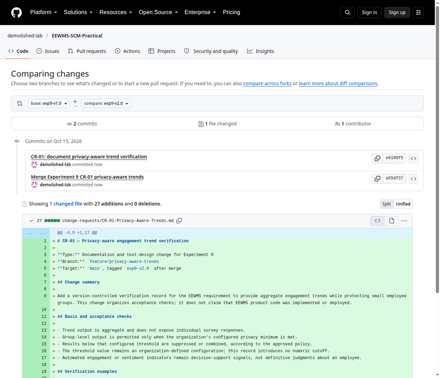
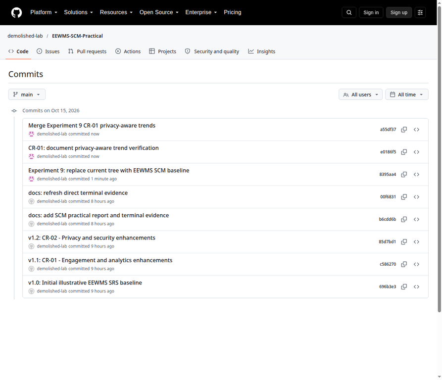
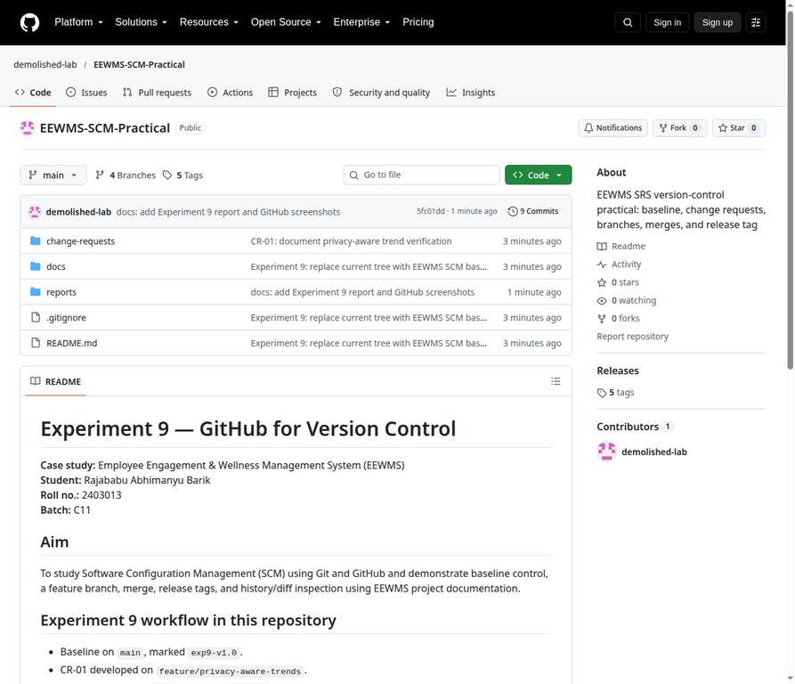

# Experiment 9 — GitHub for Version Control

## Student and case study

| Field | Value |
|---|---|
| Student | Rajababu Abhimanyu Barik |
| Roll number | 2403013 |
| Batch | C11 |
| Case study | Employee Engagement & Wellness Management System (EEWMS) |
| Repository | [demolished-lab/EEWMS-SCM-Practical](https://github.com/demolished-lab/EEWMS-SCM-Practical) |
| Visibility | Public |
| Default branch | `main` |

## 1. Aim

To study Software Configuration Management (SCM) using Git and GitHub and demonstrate configuration-item control, baseline creation, feature branching, merging, release tags, and version-history inspection for EEWMS project documentation.

## 2. Theory

Git is a distributed version-control system. A repository records file snapshots and their history; branches isolate a change until it is merged; tags give stable names to baselines or releases.

| Git stage | Role |
|---|---|
| Working directory | Files are edited locally. |
| Staging area (index) | Selected changes are prepared with `git add`. |
| Repository (`.git`) | `git commit` records a snapshot and its history. |

## 3. Configuration items

The Experiment 9 items are listed in [`docs/CI_Register.md`](../docs/CI_Register.md). The baseline contains an EEWMS SRS summary, README, and CI register. CR-01 adds a privacy-aware aggregate-trend verification record on a feature branch. The repository contains documentation only—no employee wellness data, credentials, or production code.

## 4. Procedure and actual Git record

### Step 1 — Replace the current tree with the Experiment 9 baseline

The existing public repository's latest tree was updated to Experiment 9. The older Experiment 10 commits and tags were preserved. The new baseline was committed on `main` and marked with a distinct tag so the legacy `v1.0` tag was not moved.

```text
git commit -m "Experiment 9: replace current tree with EEWMS SCM baseline"
# [main 8395aa4] Experiment 9: replace current tree with EEWMS SCM baseline
# 11 files changed, 77 insertions(+), 442 deletions(-)

git tag -a exp9-v1.0 -m "Experiment 9 Version 1 baseline"
```

The removal of earlier report/screenshots affects the current tree only. Their old commits and original tags remain in Git history.

### Step 2 — Develop CR-01 on a feature branch

CR-01 records verification checks for privacy-aware aggregate engagement trends. It uses the organization's configured privacy minimum and adds no invented numeric cutoff. This is a documentation/test-design change only; it does not claim EEWMS product code was implemented.

```text
git switch -c feature/privacy-aware-trends
# Switched to a new branch 'feature/privacy-aware-trends'

git add change-requests/CR-01-Privacy-Aware-Trends.md
git commit -m "CR-01: document privacy-aware trend verification"
# [feature/privacy-aware-trends e0186f5]
# 1 file changed, 27 insertions(+)
```

### Step 3 — Merge the change and tag the Experiment 9 release

A non-fast-forward merge commit was used so the branch integration remains visible in the history graph.

```text
git switch main
git merge --no-ff feature/privacy-aware-trends \
  -m "Merge Experiment 9 CR-01 privacy-aware trends"
# Merge made by the 'ort' strategy.
# 1 file changed, 27 insertions(+)

git tag -a exp9-v2.0 \
  -m "Experiment 9 Version 2.0: CR-01 merged"
```

### Step 4 — Verify history, tags, and the change

```text
git log --oneline --graph --decorate --all
*   a55df37 (HEAD -> main, tag: exp9-v2.0) Merge Experiment 9 CR-01 privacy-aware trends
|\
| * e0186f5 (feature/privacy-aware-trends) CR-01: document privacy-aware trend verification
|/
* 8395aa4 (tag: exp9-v1.0) Experiment 9: replace current tree with EEWMS SCM baseline
* 00f6831 (origin/main) docs: refresh direct terminal evidence
...

git diff --stat exp9-v1.0 exp9-v2.0
 change-requests/CR-01-Privacy-Aware-Trends.md | 27 +++++++++++++++++++++++++++
 1 file changed, 27 insertions(+)
```

## 5. Version and tag register

| Version point | Branch/tag | Commit | Meaning |
|---|---|---|---|
| Experiment 9 baseline | `main`, `exp9-v1.0` | `8395aa4` | Replaced the current tree with the EEWMS SCM practical baseline |
| Change request | `feature/privacy-aware-trends` | `e0186f5` | Added CR-01 verification record |
| Experiment 9 release | `main`, `exp9-v2.0` | `a55df37` | Merged CR-01 with a visible merge commit |

The earlier tags `v1.0`, `v1.1`, and `v2.0` were retained unchanged and still refer to the earlier repository history. The new `exp9-` prefix avoids tag-name conflicts.

## 6. GitHub publication verification

The repository is public at the URL above and GitHub reports `main` as the default branch. The release push published `main` at `a55df37`, `feature/privacy-aware-trends` at `e0186f5`, and tags `exp9-v1.0` and `exp9-v2.0`. A later report/screenshot commit advanced `main` to `5fc01dd`; the feature branch and all tag targets remained unchanged. The root-page capture records `main` at `5fc01dd` before that screenshot file was added.

The previous Experiment 10 report and screenshots are no longer present in the current `main` tree. Because history was preserved, their earlier versions remain reachable in older commits; no history rewrite or force push was used.

## 7. Screenshot evidence

The following images are direct captures of the public GitHub pages for this repository.

**Figure 1 — CR-01 diff from `exp9-v1.0` to `exp9-v2.0`.**



**Figure 2 — Main-branch commit history, including the Experiment 9 baseline and merge above the retained earlier history.**



**Figure 3 — Current public repository root showing the Experiment 9 README and file list.**



Capture page URLs and notes are listed in [`screenshots/README.md`](screenshots/README.md).

## 8. Conclusion

The Experiment 9 workflow established a controlled EEWMS baseline, developed CR-01 on a feature branch, merged it to `main`, and tagged the baseline and release without moving the earlier tags. The current repository tree and screenshots now present Experiment 9, while the prior commits remain available for historical traceability.
